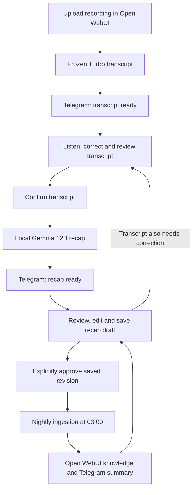

# Using SMARTINI’s from recording to knowledge

This guide describes the workflow updated on 30 October 2026. Open WebUI remains the entry point; processing runs locally on MINISFORUM. You review the transcript before Gemma writes the recap, then confirm the recap before it can enter knowledge.

## 1. Upload a recording

Sign in to Open WebUI with the account that should own the meeting. Choose the SMARTINI’s meeting Function in a saved chat. Enter a useful title, the actual meeting date and optional participants; choose the audio file and select **Upload & transcribe**.

Audio language detection is automatic, including English/Dutch/Italian code-switching. There are no audio-language checkboxes. The recap language preference is independent. Optional speaker separation adds processing time and produces estimated voice labels, not identified people.

Once the upload is accepted, its durable job continues if the chat connection closes. Use the meeting dashboard to find it again; the chat also supports `status JOB_ID`. Avoid submitting the same audio again just because processing takes time.

## 2. Review the transcript

Telegram links to the meeting when the transcript is ready. Open the **Transcript** tab. Use the audio player and timestamp buttons to listen around a passage. Search spoken wording, or show only flagged turns. The transcript is one scrollable document of readable timestamped paragraphs. Word-sized speaker fragments are grouped for display without changing the saved source. Choose **Edit paragraph** only where needed; filtering retains unsaved edits. Individual paragraph checkmarks are optional.

Flags can indicate low recognition confidence, fallback decoding, repetition, uncertain or overlapping speakers, or an amount worth checking. They are suggestions for listening, not reliable error detectors. Check unflagged passages too, especially names, numbers, commitments, dates, negation and decisions.

- Edit the wording of a paragraph without changing its start/end interval. A saved wording replacement creates a new paragraph segment with source-turn provenance. The original ASR wording remains in the saved source/history.
- Add a review note if a name, number or interpretation remains unresolved. Do not invent a correction when the audio is unclear.
- Mark a checked turn **Checked by me**. This acknowledges your review; it does not establish that the model was correct.
- Use the individual turn’s speaker field only if you personally recognise that speaker. Cluster-wide names in **Details & speakers** remain estimates and cannot prove an action owner.
- Select **Exclude from recap** for material the recap should ignore. The recording and original transcript are retained.
- If the recorder ran after the meeting ended, enter **Actual meeting end** as total minutes and seconds. Turns starting after that point are excluded; review any turn that crosses it and correct its wording if needed.

Use **Save transcript draft** to pause. You can save up to 500 edited paragraphs at once. **Download transcript** exports the saved revision as readable timestamped text; **Download JSON** preserves the detailed source. Unsaved edits must be saved before downloading if you want them included. The saved revision stays unconfirmed and does not start Gemma. If you also edited recap/details, save those changes separately before submitting transcript changes.

## 3. Confirm the transcript and generate a recap

When the transcript is good enough, tick **I reviewed this transcript and accept any remaining uncertainty**, then select **Confirm transcript & generate recap**. This queues a durable local Gemma 12B task. Transcript edits do not rerun Whisper.

The generator includes the reviewed, non-excluded transcript, user corrections and unresolved notes. Long meetings are processed in bounded chunks covering the full included source, then consolidated. It distinguishes proposals from decisions, conditional actions from completed work and work discussion from personal chatter. These instructions improve the draft but do not guarantee factual accuracy.

The dashboard refreshes while generation is pending. Telegram announces when the recap is ready. If generation fails, open **Generation details & recovery**. It shows the reason, completed stages, response stop reasons, available token counts and a downloadable log. Use **Retry recap generation** to resume saved stages; truncated output gets one bounded compact-output recovery request. No ASR is rerun.

You can also choose **Use recovered partial draft**, download saved working text or **Import recap file** (`.txt`/`.md`). Partial notes may be incomplete or overlap; check and edit them against the transcript. With a confirmed transcript, your manually written recap can be saved even if AI generation failed. Saving still does not approve it. An uncertain connection response should be checked against the current revision before retrying.

## 4. Review, edit and approve the recap

In **Recap**, read the draft against the reviewed transcript. Check coverage, names, owners, dates, costs and conditions. Remove unsupported claims and distinguish an agreed task from a suggestion. Use **Edit recap** to change the text; Markdown is supported.

**Save and close** stores a new draft revision. It does not approve or ingest it. Reopen the saved draft and choose **Approve for knowledge base**, then confirm that exact revision in the dialog. Unsaved edits, pending generation and a stale transcript prevent approval.

If the transcript needs another correction, return to Transcript. Its new saved revision invalidates the recap until you confirm the transcript, regenerate and separately approve the replacement. The previous approved snapshot is retained.

## 5. Nightly ingestion and Telegram

The existing build runs at **03:00 Europe/Amsterdam**, every day. Keep the server awake and connected. It ingests explicitly approved snapshots, compares content hashes and avoids re-embedding unchanged reports. For an update it verifies the new collection entry before detaching the previous indexed entry. Earlier uploaded resources remain available for rollback.

Telegram gives the run status, new recaps, updated recaps, total recaps in the collection, errors and the ingestion-dashboard link. A zero-change run is normal. A failed or deferred run does not mean a draft was indexed. Missed runs are not automatically caught up by the current timer; see the operations guide for a controlled run.

The meeting dashboard displays **Current**, **Approved** and **Indexed** separately. Indexed status reflects the ingestion ledger, rather than a fresh query of the remote collection. If needed, check Open WebUI Knowledge and ask a question whose answer you can verify against the saved report.

## 6. Update an existing report

Open any owned meeting, including an indexed report. Edit the recap and save; approve the new revision after reviewing it. At the next build its changed approved content replaces the indexed version without creating a second managed copy. Until then, the previous approved report remains the knowledge source.

Use **Revision history** to read earlier recaps. Do not edit immutable `review/rNNNNNN` files directly or overwrite root `report.md` expecting automatic ingestion: approval binds exact snapshot hashes. The dashboard is the supported editing route.

## Keeping data private

Transcription and recap inference remain local. Telegram receives the requested status notifications and meeting titles, not audio/transcripts for cloud inference. Source files, caches, revisions, configuration, passwords and tokens do not belong in Git. Private backups remain on the server; Git is a code/documentation copy, not a meeting-data backup.

For quick actions use [the usage cheat sheet](USAGE-CHEATSHEET.md). For service operation and recovery use [the operations cheat sheet](OPERATIONS-CHEATSHEET.md) and [2.7.0 deployment notes](REVIEW-FLOW-2.7.0.md).
